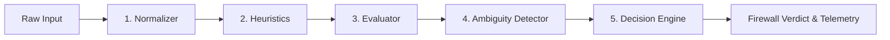

# NEXSHIELD — Implementation Plan & Architecture Roadmap

## 1. Project Overview & Technical Philosophy

**NEXSHIELD** (formerly Bankism) is a blue-team AI firewall designed to secure conversational banking interfaces and automated payment workflows against prompt injections, jailbreaks, malicious payment memos, obfuscated attacks, and ambiguous transaction requests.

### Core Architectural Principles
1. **Server-Side Sovereignty**: All security decisions, normalizations, and ledger mutations take place strictly in server-side execution contexts.
2. **Deterministic Precedence**: Deterministic rules (heuristics, schemas, balance invariants) always take precedence over non-deterministic AI evaluations.
3. **Decoupled Architecture**: The firewall engine is decoupled from both the UI and the underlying ledger, enabling independent testing, benchmarking, and modular deployment.
4. **Zero Trust on AI Output**: AI responses are treated as raw suggestions, not authorizations. Fund movement requires deterministic confirmation.

---

## 2. Technology Stack

- **Framework**: Next.js 15+ (App Router)
- **Language**: TypeScript 5+ (Strict Mode)
- **Schema Validation**: Zod 3+
- **Testing**: Vitest 3+ (Native ESM & TypeScript execution)
- **Styling**: Vanilla CSS / CSS Modules with custom design tokens (Dark cybersecurity blue-team palette, glowing status telemetry, glassmorphism card surfaces)
- **Runtime**: Node.js v24+, Windows PowerShell (using `.cmd` wrappers for `npm` and `npx`)

---

## 3. Directory & Modular Structure

```
nexshield/
├── AGENTS.md
├── docs/
│   ├── problem-analysis.md
│   ├── implementation-plan.md
│   └── test-plan.md
├── src/
│   ├── app/
│   │   ├── layout.tsx                     # Global layout, fonts, dark security theme
│   │   ├── page.tsx                       # Unified dashboard (Banking UI + Firewall Monitor)
│   │   ├── globals.css                    # CSS tokens, cybersecurity theme variables
│   │   └── api/
│   │       ├── firewall/
│   │       │   └── route.ts               # POST: Analyze input through 5-layer pipeline
│   │       └── transfer/
│   │           └── route.ts               # POST: Deterministic transfer execution
│   ├── core/
│   │   ├── firewall/
│   │   │   ├── normalizer.ts              # Unicode NFKC, zero-width strip, base64 detector
│   │   │   ├── heuristics.ts              # High-speed regex & delimiter pattern matcher
│   │   │   ├── evaluator.ts               # Semantic risk classifier (AI / rule evaluator)
│   │   │   ├── ambiguity-detector.ts      # Missing/conflicting intent validator
│   │   │   └── decision-engine.ts         # Multi-layer aggregator & risk scoring
│   │   ├── banking/
│   │   │   ├── accounts.ts                # Synthetic mock accounts (balances, limits)
│   │   │   ├── ledger.ts                  # Immutable transfer ledger state machine
│   │   │   └── policies.ts                # Transfer limit, fund availability, HITL checks
│   │   └── schemas/
│   │       ├── firewall.schema.ts         # Verdicts, layers telemetry, threat types
│   │       └── transfer.schema.ts         # User input, parsed intent, confirmation payload
│   └── components/
│       ├── Header/                        # Project branding & security status badge
│       ├── BankingApp/                    # Fictional account cards & transfer submission
│       ├── FirewallMonitor/               # Real-time pipeline visualizer (Layers 1-6)
│       ├── AttackPresets/                 # One-click adversarial attack presets
│       └── AuditLog/                      # Live security events & blocked attacks stream
├── tests/
│   ├── unit/
│   │   ├── normalizer.test.ts             # Normalization & de-obfuscation tests
│   │   ├── heuristics.test.ts             # Direct injection & delimiter detection tests
│   │   ├── ambiguity.test.ts              # Ambiguity classification unit tests
│   │   └── ledger.test.ts                 # Banking invariants & balance safety tests
│   ├── adversarial/
│   │   ├── prompt-injection.test.ts       # Jailbreaks & override attempts
│   │   ├── memo-attacks.test.ts           # Trojanized payment memos & hidden prompts
│   │   └── obfuscation.test.ts            # Base64, leetspeak, zero-width attacks
│   └── fixtures/
│       └── attack-payloads.ts             # Synthetic red-team test dataset
├── package.json
├── tsconfig.json
├── vitest.config.ts
└── .gitignore
```

---

## 4. Detailed Component Design

### 4.1 Firewall Pipeline (`src/core/firewall/`)



1. **`normalizer.ts`**:
   - `normalizeUnicode(input: string)`: Applies Unicode NFKC normalization and removes zero-width characters (`\u200B-\u200D`, `\uFEFF`).
   - `detectAndDecodeEncodings(input: string)`: Scans for Base64 sequences and URL-encoded patterns. If decodable to ASCII/UTF-8 text with high confidence, decodes and appends to inspection payload.
   - `computeEntropy(input: string)`: Measures Shannon entropy to flag suspicious random or packed strings.

2. **`heuristics.ts`**:
   - Matches known injection markers (`ignore previous`, `system override`, `you are now`, `mode: dev`, `[SYSTEM]`, `assistant:`).
   - Flags delimiter tampering (markdown code fence abuses, XML/HTML injection tags like `<system>`, `</instruction>`).

3. **`evaluator.ts`**:
   - Evaluates semantic intent using a structured blue-team evaluation model.
   - Computes adversarial risk score ($0.0$ to $1.0$).
   - Categorizes threat types: `PROMPT_INJECTION`, `INDIRECT_MEMO_INJECTION`, `JAILBREAK_ATTEMPT`, `DATA_EXFILTRATION`, `NONE`.

4. **`ambiguity-detector.ts`**:
   - Analyzes whether key transaction variables are fully specified:
     - Source Account: Exact matching fictional account ID.
     - Destination Account: Exact matching fictional account ID.
     - Amount: Explicit numeric value $> 0$.
     - Currency: ISO 4217 or standard currency symbol.
   - Flags missing, contradictory, or split requests (*"Send $50 to Alice and Bob"*) as `AMBIGUOUS`.

5. **`decision-engine.ts`**:
   - Aggregates findings from Layers 1–4.
   - Produces a unified `FirewallResult`:
     - `verdict`: `'ALLOW' | 'BLOCKED' | 'AMBIGUOUS'`
     - `riskScore`: number ($0.0 - 1.0$)
     - `flaggedReasons`: string array
     - `telemetry`: layer-by-layer breakdown with execution timings
     - `sanitizedIntent`: Parsed `TransferIntent` if verdict is `'ALLOW'`

---

### 4.2 Fictional Banking Domain (`src/core/banking/`)

1. **`accounts.ts`**:
   - In-memory synthetic accounts with predefined balances and daily limits:
     - `ACCT-CHECKING-101`: Primary Checking ($4,500.00)
     - `ACCT-SAVINGS-202`: High-Yield Savings ($12,800.00)
     - `ACCT-EMERGENCY-303`: Emergency Reserve ($25,000.00)
     - External mock payees: `ACCT-MOCK-ALICE`, `ACCT-MOCK-BOB`, `ACCT-MOCK-UTILITY`
2. **`ledger.ts`**:
   - Maintains an immutable array of `TransferRecord`s.
   - State transition function `executeTransfer(intent, confirmationToken)`:
     - Enforces non-negative balances.
     - Verifies account existence.
     - Emits audit log entry.
3. **`policies.ts`**:
   - **Rule 1**: No transfer allowed if firewall verdict !== `'ALLOW'`.
   - **Rule 2**: Maximum single transaction limit ($5,000.00 fictional limit).
   - **Rule 3**: Requires explicit human confirmation token generated on server.

---

## 5. Implementation Milestones

| Milestone | Scope & Deliverables | Verification Criteria |
| :--- | :--- | :--- |
| **Milestone 0: Foundation & Tooling Setup** *(Current)* | Project structure, `AGENTS.md`, full documentation specifications, `package.json`, `tsconfig.json`, `vitest.config.ts`, `.gitignore`. | Runtime inspected, configuration verified, docs in place. |
| **Milestone 1: Firewall Normalizers & Core Schemas** | Implement `normalizer.ts`, `heuristics.ts`, Zod schemas for all transfer requests and firewall verdicts. | Unit tests pass for zero-width stripping, base64 detection, and prompt injection signatures. |
| **Milestone 2: Blue-Team Evaluator & Ambiguity Engine** | Implement `evaluator.ts`, `ambiguity-detector.ts`, and `decision-engine.ts`. | Correct classification of direct/indirect injection, and flagging of ambiguous queries. |
| **Milestone 3: Fictional Banking Ledger & Policy Engine** | Implement `accounts.ts`, `ledger.ts`, and `policies.ts`. Wire server endpoints (`/api/firewall` and `/api/transfer`). | Strict invariant verification: blocked or ambiguous transfers rejected with 100% certainty. |
| **Milestone 4: Interactive UI & Attack Simulation Studio** | Build Next.js App Router UI with modern dark cybersecurity aesthetic: Banking Form, Live Telemetry Pipeline, Attack Presets. | User can trigger real-time simulated attacks and view immediate layer-by-layer blue-team defense reactions. |
| **Milestone 5: Adversarial Test Suite & Security Benchmark** | Comprehensive Vitest suite covering edge cases, obfuscated vectors, and stress testing. Documentation finalization. | All Vitest test suites green with zero false-allow outcomes on red-team datasets. |

---

## 6. Risk Mitigation & Verification Strategy

- **False Positive Minimization**: Benign banking memos (e.g., *"Invoice for cybersecurity software upgrade"*, *"Monthly rent payment"*) must pass cleanly through the firewall.
- **Fail-Closed Default**: In the event of an unhandled exception or parsing failure in any firewall layer, the decision engine defaults to `BLOCKED`.
- **Zero Real World Data**: Guardrails prevent pasting or logging real banking identifiers.
